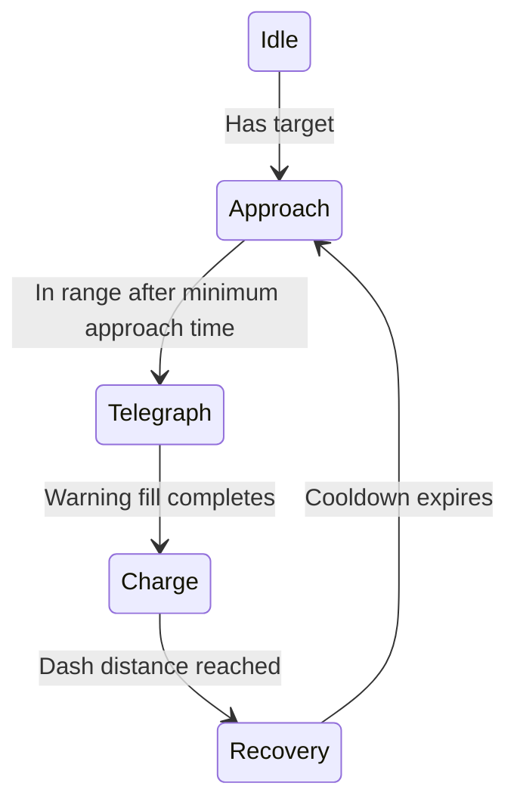
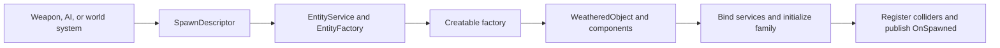

# Ultrawave — gameplay engineering portfolio breakdown

**Positioning:** Gameplay engineer and collaborative game designer on a three-developer team, with three programmers. All three developers collaborated on game design decisions. Your contributions span the game's design and gameplay implementation: enemy concepts and all current enemy AI behaviors, co-designing every weapon and writing weapon code, deciding building offerings with the team, behaviors and conditions, drops and pickups, many reusable components, upgrade-system contributions, asset integration, and Creatable spawning. Your work also includes the original Pixi-based particle implementation, a wave function collapse algorithm for background tiles, and extensive prototyping. Art creation and UI were outside your contribution areas. You integrated with and debugged physics without authoring the physics engine itself.

Authorship and development history here reflect your account; source inspection explains the current implementation. The current checkout is not a complete record of your contribution: your co-developer rewrote the particle system using your earlier implementation as its base, and the background generation and other prototypes were subsequently reworked.

Lead the portfolio page with a short gameplay reel and your broad design/engineering role. Put enemy AI, weapons, and reusable gameplay components early, then show progression, integration work, and selected prototypes. Include both current systems and earlier implementations as part of the project's development history.

## 1. General game overview

**Draft portfolio copy**

> Ultrawave is a top-down space combat game built in C# with MonoGame. Players fight through escalating enemy encounters, collect resources and experience, and develop their ship through combat upgrades and hub progression. A run moves from survival into a boss encounter before returning the player to the hub.
>
> I was one of a three-developer team. All three of us collaborated on the game's design, including enemies, weapons, buildings, and progression. I implemented every current enemy AI behavior and wrote the weapon code, along with behaviors, conditions, drops, pickups, and many reusable gameplay components. I also contributed to the upgrade system, integrated assets, and worked across the game to prototype, connect, and debug features. My earlier work included a Pixi-based particle implementation and wave function collapse background generation, both of which evolved through later rewrites. Art, UI, and Music were outsourced.

**Technical details worth including**

- The current gameplay scene starts a 15-minute survival timer, stops normal spawning for the boss encounter, and provides a 20-second loot collection phase after boss defeat. These are current tuning values, not permanent product promises.
- Enemy spawning uses timed phases with weighted archetype selection, spawn intervals, population limits, and damage multipliers.
- The scene saves the player before returning to the hub; the death path explicitly preserves collected loot.
- The project targets .NET 8 and references MonoGame DesktopGL, MonoGame.Extended, Gum for UI, and FMOD through FmodForFoxes. Describe the runtime as a custom game framework built on MonoGame.

**Media**

Make a 30–45 second overview: hub/loadout → early combat → upgrade choice → more intense combat → boss. Use brief labels to establish the gameplay loop. Include a separate role caption so viewers know which systems you contributed to.

**Source anchors:** [gameplay phases](../Ultrawave/Scenes/GameScene.cs), [enemy spawning](../Ultrawave/Services/EnemySpawnerService.cs), [saving](../Ultrawave/Services/SavingService.cs), [project dependencies](../Ultrawave/Ultrawave.csproj).

## 2. Engine overview — building gameplay on shared systems

**Draft portfolio copy**

> I wrote many of the reusable gameplay components that power Ultrawave's enemies, weapons, drops, and pickups. These run on a component-based framework built around `WeatheredObject`, which combines behavior, movement, collision, and presentation in individual game objects. My work involved implementing these features, connecting them to shared services, and debugging their interactions across the game.
>
> The physics engine was implemented by my teammate. My work involved using and debugging its integration with gameplay, including the relationships between spawned objects, collision behavior, and effects.

**Engineering details**

- **Entity composition:** `WeatheredObject` stores components by concrete type, supports interface-based lookups, and forwards initialization, update, late update, drawing, and cleanup to components. This is an entity/component architecture; the implementation does not establish a data-oriented archetype ECS.
- **Object hierarchies:** Parent/child relationships support attached hitboxes and visual effects. World position and rotation are cached, with dirty flags propagated to children. A family identifier allows related objects to be recognized together.
- **Lifecycle management:** `EntityService` queues creation, destruction, and despawning. It binds services and initializes an object's family before raising `OnSpawned`, and inserts/removes family colliders from the spatial index.
- **Scene services:** `ServiceScope` distinguishes owned services from shared references, controls update order, and disposes owned services in reverse order. Pausable services can receive scaled gameplay time while other services receive regular frame time.
- **Collision:** `PhysicsService` uses a quadtree to gather nearby candidates before detailed collision checks. It includes discrete and continuous collision paths, time-of-impact ordering, layer masks, raycasts, overlap queries, and physical response. Continuous collision handling is particularly relevant to fast projectiles.
- **Rendering context:** The renderer includes camera-based entity culling, lighting and post-processing passes, and collision debugging visuals.

**Best demonstration**

Record the same short projectile interaction twice: normal presentation, then collision debug visuals. Explain how a bullet's visible sprite, collider, travel component, and impact effects cooperate. The renderer already has `Features.ShowCollisionHitboxes` and draws continuous-collider sweeps; check how to enable it in your capture build. Do not imply there is a verified keyboard shortcut.

An annotated still of an enemy with its child hitbox and trail would also make the hierarchy concrete. Quadtree debug helpers exist, but an in-game quadtree overlay was not established in this review.

**Source anchors:** [WeatheredObject](../Ultrawave/Game/WeatheredObject.cs), [entity lifecycle](../Ultrawave/Services/EntityService.cs), [service ownership](../Ultrawave/Services/ServiceScope.cs), [physics service](../Ultrawave/Services/PhysicsService.cs), [colliders](../Ultrawave/Game/Components/CollisionComponent.cs), [quadtree](../Ultrawave/Game/Physics/Quadtree.cs), [rendering/debug drawing](../Ultrawave/Services/RenderService.cs).

## 3. Enemies and enemy AI

**Draft portfolio copy**

> I contributed enemy concepts, collaborated with the team on their design, and implemented most enemy AI behavior in the current game. I wrote behaviors and transition conditions that coordinate movement, attacks, animation, and warning effects. Composing these through a state-based framework let me turn enemy designs into distinct attack sequences, with readable telegraphs and recovery windows for the player to respond to.

**How the system works**

- `AIBehaviorStateMachine` manages the current state and an optional global override state.
- `BState` contains behaviors and conditional transitions. Conditions are checked before behaviors run; a matching condition can select randomly from multiple destination states.
- `BBehavior` exposes enter, update, and exit hooks. Actions such as moving, firing, stopping, changing animation, and starting a telegraph can be combined in a state.
- Conditions inspect time, target distance, energy, health, animation completion, and other gameplay state.
- Global transitions can interrupt the current behavior; the global override is cleared after it transitions. Fury explicitly re-arms its dormancy transition as needed.

**Strong examples to consider**

| Enemy | Implemented behavior | Engineering point |
| --- | --- | --- |
| Elephant | Approaches, stops to telegraph a dash, charges a defined distance, then recovers | Coordination of movement, visual warning, attack completion, and cooldown |
| Hunter | Moves into attack range, telegraphs, attacks, and recharges when energy runs out | Multiple gameplay conditions controlling attack availability |
| Fury | Uses an interrupting dormancy state and awakening behavior | Handling exceptional transitions outside the normal attack loop |
| Iron King | Chooses among attacks with separate telegraph, attack, and recovery states | Reusing the behavior framework for a more complex encounter |

Use one enemy as a detailed implementation case study, then show contrasting enemies to demonstrate the range of AI you implemented. Credit the enemy designs to the team's collaboration while describing your behavior and condition code in the first person.

**Media and explanation**

Capture a 15–25 second Elephant attack cycle. Add state names in the video edit; a live state overlay is not assumed to exist. Freeze briefly during the warning to explain what the player can read, then show the charge and recovery window.

Pair that with one concrete iteration story from your work: the original behavior problem, the state/condition you changed, and how the encounter felt afterward. That personal example will add more value than listing the full enemy roster.

**Source anchors:** [state machine](../Ultrawave/Game/Systems/AI/AIBehaviorStateMachine.cs), [states](../Ultrawave/Game/Systems/AI/BState.cs), [Elephant](../Ultrawave/Game/Creatables/Enemies/Elephant.cs), [Hunter](../Ultrawave/Game/Creatables/Enemies/Hunter.cs), [Fury](../Ultrawave/Game/Creatables/Enemies/Fury.cs), [Iron King](../Ultrawave/Game/Creatables/Enemies/IronKing.cs).

## 4. Weapons

**Draft portfolio copy**

> I helped design every weapon with the team and wrote the weapon code. Ultrawave's weapons separate firing behavior from the objects and effects created by an attack: a shared interface handles input and lifecycle, while each weapon controls its own firing pattern. Projectiles combine travel, collision, damage, and visual components. This allowed me to implement distinct weapon behavior and connect it to the game's spawning, collision, and upgrade systems.

Make this a primary implementation section. Use two or three contrasting weapons to explain different engineering problems, rather than giving every weapon an equally long description.

**Technical highlights**

- `IWeapon` defines press/release input, update, service binding, owner synchronization, cleanup, and a bullet-fired event. `ISecondaryFireWeapon` supports optional secondary behavior.
- `BaseWeapon` provides shared projectile quantity and scale handling. It creates spread volleys by cloning spawn descriptors and rotating their target directions.
- Target and muzzle-position interfaces allow weapon code to ask its owner for aiming information.
- Projectile Creatables combine components such as straight travel, continuous collision, damage, knockback, lifetime, and status effects.

| Weapon | Distinct behavior present in code | Suggested capture |
| --- | --- | --- |
| Axiom | Semi-automatic fire with an unlockable staged charge shot; ricochet and critical-hit shield effects | Compare a normal shot with charged fire |
| Torrent | Automatic fire; needler and cluster-round upgrades, with optional fire-rate ramping | Sustained fire followed by an upgraded hit/explosion sequence |
| Disperser | Spread fire that can become a single slug; slug damage incorporates pellet count | Same target before and after slug mode |
| Arclance | Returning projectile and unlockable orbiting secondary projectiles | Show launch, return, and orbit behavior |
| LightBlade | Sustained beam with damage ticks and upgrades such as pulse, pull, and turret beams | Beam behavior before and after one visible modifier |

**Deeper engineering example**

LightBlade explicitly refreshes the damage of an already-existing beam when damage upgrades apply. Its turret beams also need refreshing for certain upgrades. This illustrates a concrete gameplay concern within the weapon code: changing a weapon's data must also update active attacks that cached the old values. Pair the explanation with a beam upgrade demonstration.

**Source anchors:** [weapon contract](../Ultrawave/Game/Systems/Weapons/IWeapon.cs), [shared weapon implementation](../Ultrawave/Game/Systems/Weapons/BaseWeapon.cs), [weapon implementations](../Ultrawave/Game/Systems/Weapons), [Torrent projectile composition](../Ultrawave/Game/Creatables/Bullets/Torrent.cs), [LightBlade](../Ultrawave/Game/Systems/Weapons/LightBladeWeapon.cs).

## 5. Upgrades

**Draft portfolio copy**

> I collaborated on Ultrawave's progression design and contributed code to the upgrade system. The game has two connected progression layers: hub upgrades and choices made during a run. Upgrade effects expose individual changes such as damage adjustments or new weapon behavior. During a run, choices are filtered against the player's weapon, progression, and existing upgrades before weighted selection. This connects the weapon implementations to builds with prerequisites and incompatible choices.

Building selection and purpose were also part of the team's shared design work. Discuss the buildings as the player's route into progression, alongside your contributions to the underlying gameplay code. Screenshots of upgrade menus illustrate that flow; UI implementation belongs to your teammates.

**Distinguish the two systems**

| System | Implementation | Useful portfolio detail |
| --- | --- | --- |
| Hub/equipment progression | `UpgradePath` and `UpgradeNode` hold branches, costs, requirements, claim state, acquisition time, and effects | Separates progression structure from the operation an upgrade performs |
| Run progression | `LevelUpPoolBuilder` combines generic, dash, and equipped-weapon options; `LevelUpService` filters and samples choices | Supports weapon-specific build development within a common selection flow |

- Capability interfaces such as `IAdjustDamage` let effects operate on supported weapon features. Effects can also supply before/after values for display.
- The node structure supports branching, but the current weapon tier builder creates linear chains from tiers 2 through 10. Do not present these weapon tiers as a branching skill tree.
- Run eligibility checks level, weapon identity, permanent weapon upgrade count, stack limits, unique choices, required/forbidden tags, tag spacing, and banished options.
- The service chooses up to three weighted options without duplicates, supports rerolls and banishes, and attempts to include the scheduled milestone category when eligible options exist.
- Pending levels are queued. Time dilation introduces the level-up feedback before selection pauses gameplay.

**Media**

Show a short before/choice/after sequence using a visibly different attack. Disperser's slug mode or Arclance's orbit mode will communicate behavior changes more clearly than a damage number alone. Add a screenshot of a hub upgrade separately so visitors understand the two progression layers.

**Source anchors:** [upgrade nodes](../Ultrawave/Game/Systems/UpgradeSystem/UpgradeNode.cs), [damage effect](../Ultrawave/Game/Systems/UpgradeSystem/Effects/AdjustDamageEffect.cs), [weapon tiers](../Ultrawave/Game/Systems/Weapons/WeaponTierUpgradePathBuilder.cs), [pool construction](../Ultrawave/Game/Systems/LevelUps/LevelUpPoolBuilder.cs), [eligibility](../Ultrawave/Game/Systems/LevelUps/LevelUpEligibility.cs), [selection flow](../Ultrawave/Services/LevelUpService.cs).

## 6. Creatables — assembling and spawning gameplay objects

**Draft portfolio copy**

> I wrote many gameplay components, including behaviors, conditions, drops, and pickup logic, and worked with Creatables to assemble and spawn game objects. Creatables are factory methods that build `WeatheredObject` instances from reusable components. A projectile combines travel, collision, damage, lifetime, and graphics; an enemy adds AI, targeting, health, and drops. This work connected individual features to object initialization, collision registration, and cleanup throughout the game.

**How spawning connects the systems**

- `SpawnDescriptor` carries an archetype name, transform, persistence information, and an `Extra` dictionary of creation parameters.
- `EntityFactory` maps archetype names such as `Projectile.Torrent` and `Field.Bombardment` to their construction functions.
- A Torrent bullet includes team and creator information, lifetime, continuous collision, physical movement, travel, damage, knockback, and presentation. Its needler variant conditionally adds another hit-effect component.
- `SpawnBombardmentFieldOnDestroyEffectComponent` subscribes to deletion and requests a field through the same spawning API. The field combines detection, targeting, timed damage, lifetime, and particle presentation.
- Construction parameters are flexible but string-keyed and cast at runtime. This is a useful tradeoff to discuss if you debugged missing keys, wrong value types, or initialization order.

**Drops and pickups as an additional implementation example**

Your drop and pickup work deserves explicit space here. In the current code, `DropOnDeathComponent` responds to a health death event, while `DropComponent` rolls drop chances and quantities and requests `Drop.*` archetypes through `EntityService`. `AddResourceWithDelayComponent` gates pickup availability with a timer. These provide a compact example of reusable components connecting combat outcomes to resources and progression.

Suggested clip: enemy death → resource spawn → pickup → resource gain. Explain the event and component responsibilities alongside the visible result. Source anchors: [death-triggered drops](../Ultrawave/Game/Components/DropOnDeathComponent.cs), [drop selection and spawning](../Ultrawave/Game/Components/DropComponent.cs), [pickup timing](../Ultrawave/Game/Components/AddResourceWithDelayComponent.cs).

**Media**

Show an upgraded cluster round leaving a bombardment field. Add three labels: projectile → destruction event → timed field. Pair it with a small component diagram or a cropped construction snippet. Keep the emphasis on how one gameplay action creates another through reusable systems.

**Source anchors:** [spawn descriptor](../Ultrawave/Game/Data/SpawnDescriptor.cs), [factory dispatch](../Ultrawave/EntityFactory.cs), [entity lifecycle](../Ultrawave/Services/EntityService.cs), [Torrent](../Ultrawave/Game/Creatables/Bullets/Torrent.cs), [field creation on destruction](../Ultrawave/Game/Components/Weapons/Effects/OnDestroy/SpawnBombardmentFieldOnDestroyEffectComponent.cs), [bombardment field](../Ultrawave/Game/Creatables/BombardmentField.cs).

## 7. Particle system

**Draft portfolio copy**

> I implemented Ultrawave's original particle integration using the Pixi particle system. That implementation became the base for a later rewrite by my co-developer. My contribution belongs to the game's development history: getting particle effects into the game and establishing the earlier implementation that the current system grew from.

Use an earlier build, recording, or code revision to explain your implementation in detail. The original integration's exact APIs and features have not been reconstructed in this review. The source notes below describe the current rewritten system and provide context for how the feature evolved.

**Technical details in the current rewritten implementation**

- **Configuration:** `ParticleSystemConfig` is loaded from JSON. It defines emission rate and particle limits, lifetime, speed and acceleration, rotation, animation settings, tint, alpha, and changes over a particle's life.
- **Emission geometry:** The emitter supports point, line, circle, filled circle, box outline, filled box, and a `boxUniform` mode.
- **Sprite support:** Constructors accept sprites, sprite lists, animations, or animation lists. Configured modes control how visuals are selected.
- **Reuse:** Each emitter has a particle pool and pools for static sprites. `ParticleEmitterPool` additionally reuses hit emitters by configuration. Returned emitters clear active particles and reset before use.
- **Hot-path work:** The emitter caches derived settings such as parsed colors, radians, and emission intervals. This avoids repeating that setup for each particle.
- **Attachment:** Effects can leave particles in world space or move active particles with the emitter.
- **Gameplay-driven intensity:** Configuration helpers scale emission, size, and speed for buildup effects. Updating configuration affects future particles, allowing the effect to change gradually without resetting all existing particles.

Credit the current rewrite to your co-developer. Its pooling and configuration features can explain the project's evolution, but should not be presented as features of your original integration without historical evidence. Quantified performance comparisons would need measurements from the relevant builds.

**Media**

Prefer a 20–30 second reel from an earlier build showing your particle work. If footage from both versions exists, use a labeled original/current comparison to explain the evolution. Current footage can show where the feature ended up, with a caption crediting the rewrite. A parameter comparison should use the version whose implementation you are discussing.

Suggested caption: “Original Pixi-based particle integration: my implementation. Current particle system: subsequent rewrite by my co-developer.”

**Source anchors:** [emitter](../Ultrawave/Game/Systems/Particles/ParticleEmitter.cs), [particle simulation](../Ultrawave/Game/Systems/Particles/Particle.cs), [configuration](../Ultrawave/Game/Sprites/ParticleSystemConfig.cs), [hit-emitter pool](../Ultrawave/Game/Systems/Particles/ParticleEmitterPool.cs), [effect configurations](../Ultrawave/Content/Particles), [reuse tests](../Ultrawave.Test/Game/Systems/Particles/ParticleEmitterPoolTests.cs).

**Development history:** Your clarification resolves the README/current-code difference: the original implementation used Pixi, and your co-developer later rewrote it. Both stages belong in the project's history, with their respective contributions credited.

## 8. Asset management and integration

**Draft portfolio copy**

> I integrated the team's art assets into Ultrawave's gameplay pipeline, connecting sprite sheets and animation data to runtime objects and effects. Assets are organized into category-specific wrappers and retrieved through a shared atlas manager. The pipeline uses packed texture metadata to preserve sprite placement and animation alignment, while collision geometry is loaded separately from exported hitbox data. My contribution was the technical integration; my teammates created the art and UI.

**Engineering details**

- The repository contains TexturePacker project files and PhysicsEditor exports, providing useful examples of the path from authoring tools to runtime data.
- `TextureAtlas` combines a texture loaded through MonoGame's content manager with JSON frame metadata. It passes packed rotation, trimmed offsets, original source size, and pivots into `WSprite`.
- `TextureAtlasManager` caches atlases by name, avoiding repeated construction for a name already loaded. Required lookups throw clear exceptions for missing atlases or sprites.
- `AssetsService` coordinates category wrappers for enemies, weapons, buildings, biomes, particles, and other content. These wrappers expose named sprites and animations for gameplay code.
- The atlas loader checks that atlas textures are compressed. This is a format validation, not a measured memory saving.
- `ColliderDatabase` loads `Content/SpriteHitboxes.json` and exposes composite polygon geometry by collider type.
- Atlas disposal clears its sprite dictionary; the underlying texture comes from `ContentManager`. Do not describe atlas removal as independently freeing the texture's GPU memory.

**Media**

Use a three-part still or short screen recording: packed atlas → a few named animation frames → the asset animating in game. Add hitbox outlines to show how visual and collision data meet. Discuss one asset integration issue you actually solved, such as alignment, naming, frame order, or collider mismatch.

**Source anchors:** [asset coordination](../Ultrawave/Services/AssetsService.cs), [atlas manager](../Ultrawave/Game/Sprites/TextureAtlasManager.cs), [atlas parsing](../Ultrawave/Game/Sprites/TextureAtlas.cs), [sprites](../Ultrawave/Game/Sprites/WSprite.cs), [particle asset wrapper](../Ultrawave/Game/Assets/ParticleAssets.cs), [collider database](../Ultrawave/Game/Physics/ColliderDatabase.cs), [TexturePacker files](../Art/PixelArt/TexturePackerFiles), [PhysicsEditor files](../Art/PixelArt/PhysicsEditorFiles).

## Development history — procedural backgrounds and prototyping

**Draft portfolio copy**

> I wrote a wave function collapse algorithm for background tile generation and built numerous gameplay prototypes during development. The background system and many prototypes were later reworked as the game evolved. These earlier implementations were part of my engineering contribution alongside the systems that remain in the current game.

This history comes from your account. The original WFC implementation and the reasons for its replacement have not been reconstructed from repository history in this review. For a focused case study, recover one earlier revision and show its inputs, generation process, and resulting background. Explain the actual constraints, selection strategy, and contradiction handling your implementation used once that code is available.

Suggested media: tileset → generation steps → generated background. If only an older output screenshot survives, label it as a prototype and explain the implementation separately. A later background renderer cannot serve as direct evidence of the earlier algorithm.

For another prototype, describe the design question it explored, what you built, what the team learned, and how that informed the next version. A replaced system can demonstrate implementation and iteration skills without needing to have survived unchanged into the current build.

## Capture priorities and supporting evidence

Treat this as a capture plan, not a list of existing media. Start with these five items; they can support most of the page without requiring eight separate long videos.

| Priority | Capture | Sections supported | What the viewer should understand |
| --- | --- | --- | --- |
| 1 | One enemy attack cycle with state labels | AI, engine | How behavior, telegraphing, and recovery fit together |
| 2 | Contrasting weapon behaviors, then before → upgrade choice → after | Weapons, upgrades | Your weapon implementations and their connections to progression |
| 3 | Original particle footage, optionally paired with the credited rewrite | Particles, development history | Your initial implementation and the system's evolution |
| 4 | Projectile impact and field creation, or enemy death and resource pickup | Engine, Creatables, drops | Collision and lifecycle events driving your gameplay components |
| 5 | Atlas/frame metadata → in-game animation, plus a short hub/combat montage | Assets, overview | Asset integration and the larger game loop |

For each clip, write one sentence about your contribution and one about the engineering decision. Use video-edit labels for explanatory overlays unless runtime tooling is confirmed. Keep code screenshots short enough to read at the website's actual display size.

The repository also contains useful testing evidence: [entity hierarchy/lifecycle tests](../Ultrawave.Test/Game/WeatheredObjectTests.cs), [spatial queries and collision event tests](../Ultrawave.Test/Services/PhysicsServiceTests.cs), [AI transition tests](../Ultrawave.Test/Game/Systems/AI/StateMachineTests.cs), [upgrade tests](../Ultrawave.Test/Game/Systems/UpgradeSystem), [level-up tests](../Ultrawave.Test/Game/Systems/LevelUps), and [particle reuse tests](../Ultrawave.Test/Game/Systems/Particles/ParticleEmitterPoolTests.cs). The [CI workflow](../.github/workflows/tests.yml) is configured to run tests with coverage collection. These are source-inspected supporting materials, not a claim that this revision passes or that you authored every test.

Before final publication, add the project dates and team credits, then choose a few detailed problem-solving examples from your AI, weapons, components, upgrades, and prototype work. Credit game design as a collaboration among all three developers and describe your implementation work directly. Add historical footage or source for the original particles and WFC background generator where available. If performance is part of a case study, capture hardware, resolution, entity/effect counts, frame-time measurements, and the exact comparison being made.
